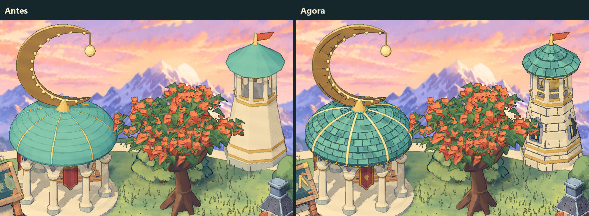

# Lumon · Observatório do Amanhecer

Hub cooperativo para até seis jogadores, em Unity **6000.3.28f1**. A praça usa construções giráveis em Gaussian splats, cenário ilustrado e uma folha de animação direcional para a guardiã.



## Abrir e jogar

1. Clone o repositório e adicione a pasta ao Unity Hub com a versão indicada em [ProjectVersion.txt](ProjectSettings/ProjectVersion.txt).
2. Abra [HubWorld.unity](Assets/Lumon/HubWorld/HubWorld.unity) e entre em Play Mode. Os assets jogáveis acompanham o clone.
3. Use WASD ou as setas para andar, Q/R para girar a câmera, V para a vista geral e E junto a uma estação. F aproxima a câmera da forja. O botão Grupo abre a sala LAN.

## Trabalhar com a mesma direção de arte

A [skill de design do Lumon](Plugins/lumon-design/skills/lumon-design/SKILL.md) reúne a referência aprovada da forja, a paleta por material, o atlas da guardiã, as fontes de autoria e o teste visual. Humanos e assistentes podem abrir o Markdown diretamente. A [pasta do plugin](Plugins/lumon-design) também contém os manifestos de Codex e Kimi para a mesma skill. O [AGENTS.md](AGENTS.md) aponta os assistentes de código para essa referência.

Para começar uma tarefa de arte, por exemplo, peça **“Use a skill lumon-design para modelar um arquivo de cartas ao lado do pavilhão. Compare a fachada na câmera da praça antes e depois.”** Os [comparativos das estações](QA/Arquitetura-do-Observatorio/estacoes-antes-e-agora.jpg) mostram o nível de detalhe na distância de jogo.

## Compilar e conferir a versão Windows

Execute na raiz do clone, com o componente Windows Build Support instalado. Ajuste o caminho do Editor para a sua instalação.

```powershell
$editor = "C:/Program Files/Unity/Hub/Editor/6000.3.28f1/Editor/Unity.exe"
& $editor -batchmode -nographics -quit -buildTarget Win64 -projectPath "$PWD" -executeMethod Lumon.HubWorld.Editor.HubSplatBuilder.Build -logFile "$PWD/build-lumon.log" | Out-Host
if ($LASTEXITCODE -ne 0) { throw "A compilação falhou. Consulte build-lumon.log." }
python Plugins/lumon-design/skills/lumon-design/scripts/capturar.py
```

O executável fica em `Builds/HubWorld-Win64/Lumon.exe`. O teste grava as capturas numa nova pasta de `Builds/Revisoes` e confere as oito interações. Os scripts em [Art/Gaussian](Art/Gaussian) recompõem os assets editáveis. Consulte as [notas de arquitetura](Docs/HubWorld-Design.md#acabamento-das-construções) e o [guia da guardiã](Docs/Guardiao2D.md#cartógrafa-jogável-do-amanhecer) para as decisões específicas. Os estudos anteriores continuam registrados em [Docs](Docs).
